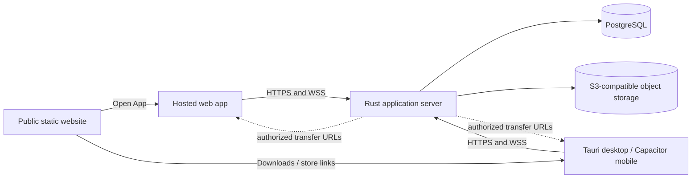

# Shared architecture

## System boundary

The frontend and public site are separate static deployments. The Rust server serves application endpoints and socket upgrades, not frontend assets. Desktop and mobile packages embed a build of the shared frontend and connect to the same independently hosted service. Do not start a private copy of the application server inside a desktop package by default.

PostgreSQL owns durable structured state. S3 owns object bytes; PostgreSQL records ownership and metadata. The server enforces access to both. Clients never receive database credentials or reusable S3 administrator credentials. Authorized direct object transfers may bypass the API for bytes; authorization and finalization still belong to the server.

## Shared contracts

| Contract | Authoritative document |
| --- | --- |
| API operations, socket framing, errors, recovery | [Server protocol](../../umbra_server/PROTOCOL.md) |
| Transactions, migrations, object lifecycle | [Server data](../../umbra_server/DATA.md) |
| Client state, platform adapters, authentication integration | [App architecture](../../umbra_app/ARCHITECTURE.md) |
| Environment names, visibility, ports, network addresses | [Configuration](CONFIGURATION.md) |
| Process hooks, startup, shutdown, infrastructure ownership | [Scripts](../../scripts/README.md) |
| Public navigation, downloads, Open App | [Site guide](../../umbra_site/README.md) |

Keep wire types independent of UI state and database structs. Begin with the protocol document and explicit serializers. Generate TypeScript types from server-owned schemas when the project has enough shared messages to benefit; do not add an empty shared package or a schema toolchain in advance. Runtime validation remains necessary at trust boundaries even if types are generated.

## Communication and consistency

Use HTTP for bounded operations where suitable and WebSockets for ongoing subscriptions and pushed changes. The transport choice does not change authorization, validation, transaction boundaries, or error semantics. A socket is not a durable queue: [recovery rules](../../umbra_server/PROTOCOL.md) must resynchronize state after reconnecting.

Keep business operations in a service layer callable by both transports. Commit durable state before announcing success or publishing changes. Initially run one server instance and one PostgreSQL database unless requirements demand more. When adding replicas, explicitly solve cross-instance event delivery and session/subscription ownership rather than assuming in-memory broadcasts reach every client.

## Development and production

Development infrastructure runs in Docker; the Rust server and frontends run on the host for normal debugging and reload. Production architecture is provider-neutral: static hosting/CDN for frontends, a long-lived service supporting WebSocket upgrades for the API, managed or self-hosted PostgreSQL, and S3-compatible storage.

Configure addresses explicitly per environment. Native applications are public clients, and their embedded configuration is readable. See [Configuration](CONFIGURATION.md) before selecting deployment origins or implementing authentication. Production deployment details belong in the component guides.
